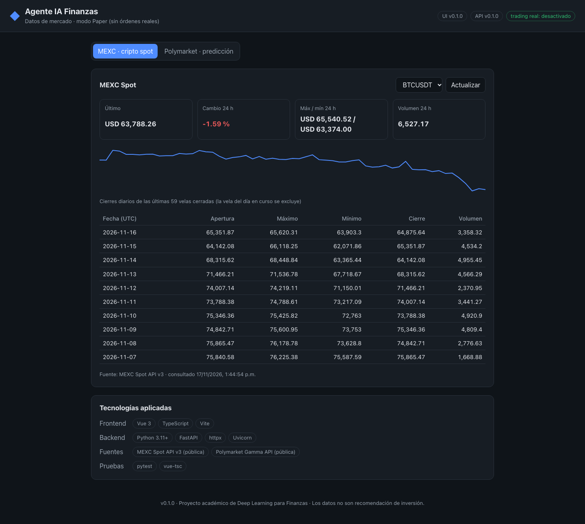

# Agente IA Finanzas


Proyecto académico de **Deep Learning para Finanzas**. Es la base del agente que observará datos de mercado, consultará un modelo predictivo, propondrá acciones, pasará controles de riesgo y simulará la ejecución en modo **Paper**, sin enviar órdenes reales.

La **v0.1.0** entrega la base: una UI en Vue + TypeScript + Vite y un backend FastAPI que consulta **dos fuentes públicas en modo solo lectura**:

| Fuente | Qué muestra | API |
| --- | --- | --- |
| **MEXC** (cripto spot) | Ticker de 24 h y velas diarias de BTCUSDT / ETHUSDT; la vela del día en curso se marca como abierta y se excluye | MEXC Spot API v3 (`/api/v3/ticker/24hr`, `/api/v3/klines`) |
| **Polymarket** (mercados de predicción) | Mercados abiertos ordenados por volumen, con la probabilidad implícita de cada resultado | Polymarket Gamma API (`/markets?active=true&closed=false`) |



> ⚠️ **Aviso:** Proyecto educativo. Ninguna ruta envía órdenes reales (`trading_real: false` fijo en el código). Los datos mostrados no son recomendación de inversión.

## Versión

| Campo | Valor |
| --- | --- |
| Versión actual | **0.1.0** (archivo [`VERSION`](VERSION), fuente única para UI y API) |
| Fecha | 2026-11-17 |
| Cambios | Ver [`CHANGELOG.md`](CHANGELOG.md) |
| Versionado | [SemVer](https://semver.org/lang/es/): `MAYOR.MENOR.PARCHE` |

La versión se ve en la cabecera de la UI (`UI v0.1.0` y `API v0.1.0`) y en `GET /api/version`.

## Tecnologías aplicadas

| Capa | Tecnologías |
| --- | --- |
| Frontend | Vue 3 (Composition API, `<script setup>`), TypeScript, Vite, CSS sin frameworks, gráfica SVG sin dependencias |
| Backend | Python 3.11+, FastAPI, httpx (cliente asíncrono con reintentos y espera creciente), Uvicorn |
| Fuentes de datos | MEXC Spot API v3 (pública), Polymarket Gamma API (pública) |
| Calidad | pytest con transportes HTTP simulados, `vue-tsc` (verificación de tipos) |
| Herramientas | Git, GitHub, Claude Code |

## Arquitectura (v0.1)

```
Navegador (Vue + TS)  ──/api──▶  Backend FastAPI  ──▶  MEXC Spot API v3 (lectura)
        ▲                           │            └──▶  Polymarket Gamma API (lectura)
        └──── JSON normalizado ─────┘
```

- El navegador **solo habla con el backend**: no hay claves ni llamadas directas a MEXC o Polymarket en el frontend.
- El backend valida símbolos e intervalos permitidos, reintenta con espera creciente y responde errores claros (`502` fuente caída o límite de solicitudes, `422` entrada no permitida).
- `GET /api/control/estado` ya está protegida con API key (`X-API-Key`) como base para iniciar, pausar y detener el agente en versiones siguientes.

## Estructura

```
agente-ia-finanzas/
├── VERSION                 # 0.1.0
├── CHANGELOG.md
├── CLAUDE.md               # instrucciones para Claude Code
├── .env.example            # variables sin valores reales
├── backend/
│   ├── app/
│   │   ├── main.py         # rutas FastAPI
│   │   ├── config.py       # configuración por variables de entorno
│   │   ├── errors.py       # errores controlados y reintentos
│   │   └── providers/
│   │       ├── mexc.py
│   │       └── polymarket.py
│   ├── tests/test_api.py
│   └── requirements.txt
└── frontend/
    ├── src/
    │   ├── App.vue
    │   ├── api.ts          # tipos y cliente del backend
    │   └── components/     # MexcPanel, PolymarketPanel, TechStack
    ├── vite.config.ts      # proxy /api → backend; versión desde VERSION
    └── package.json
```

## Instalación y ejecución

Requisitos: **Python 3.11+**, **Node.js 20.19+ o 22.12+** y npm.

```bash
git clone https://github.com/maubtw/agente-ia-finanzas.git
cd agente-ia-finanzas
cp .env.example .env            # ajusta valores; nunca subas .env
```

**Backend** (terminal 1):

```bash
cd backend
python -m venv .venv
source .venv/bin/activate        # Windows: .venv\Scripts\activate
pip install -r requirements.txt
uvicorn app.main:app --reload --port 8000 --env-file ../.env
```

Documentación interactiva de la API: http://localhost:8000/docs

**Frontend** (terminal 2):

```bash
cd frontend
npm install
npm run dev                      # http://localhost:5173
```

## Endpoints

| Método | Ruta | Descripción |
| --- | --- | --- |
| GET | `/api/health` | Estado y versión |
| GET | `/api/version` | Nombre, versión, modo y tecnologías |
| GET | `/api/mexc/ticker?simbolo=BTCUSDT` | Ticker 24 h |
| GET | `/api/mexc/velas?simbolo=BTCUSDT&intervalo=1d&limite=30` | Velas con marca `cerrada` |
| GET | `/api/polymarket/mercados?limite=20&busqueda=bitcoin` | Mercados abiertos por volumen |
| GET | `/api/control/estado` | Protegida con `X-API-Key` (401 si falta o es incorrecta) |

## Pruebas

```bash
cd backend && pytest -q          # 7 pruebas, sin salir a internet
cd frontend && npm run build     # verificación de tipos + build de producción
```

## Hoja de ruta

- [x] **v0.1.0** — Repositorio público, UI Vue + TS + Vite, backend FastAPI, datos de MEXC y Polymarket en solo lectura
- [ ] **v0.2.0** — Modelo y escalador de la práctica versionados; pronóstico del siguiente día en la UI
- [ ] **v0.3.0** — Simulador Paper (50,000 USDT, sin apalancamiento ni cortos) y persistencia SQLite sin duplicados por vela
- [ ] **v0.4.0** — Ollama local detrás de un gateway con API key; propuesta en JSON validada
- [ ] **v0.5.0** — Motor de riesgo determinista; iniciar, pausar y detener protegidos
- [ ] **v1.0.0** — 20 ciclos diarios reales, nueve errores demostrados y comparación sin LLM, con LLM y comprar y mantener

## Licencia

[MIT](LICENSE)
